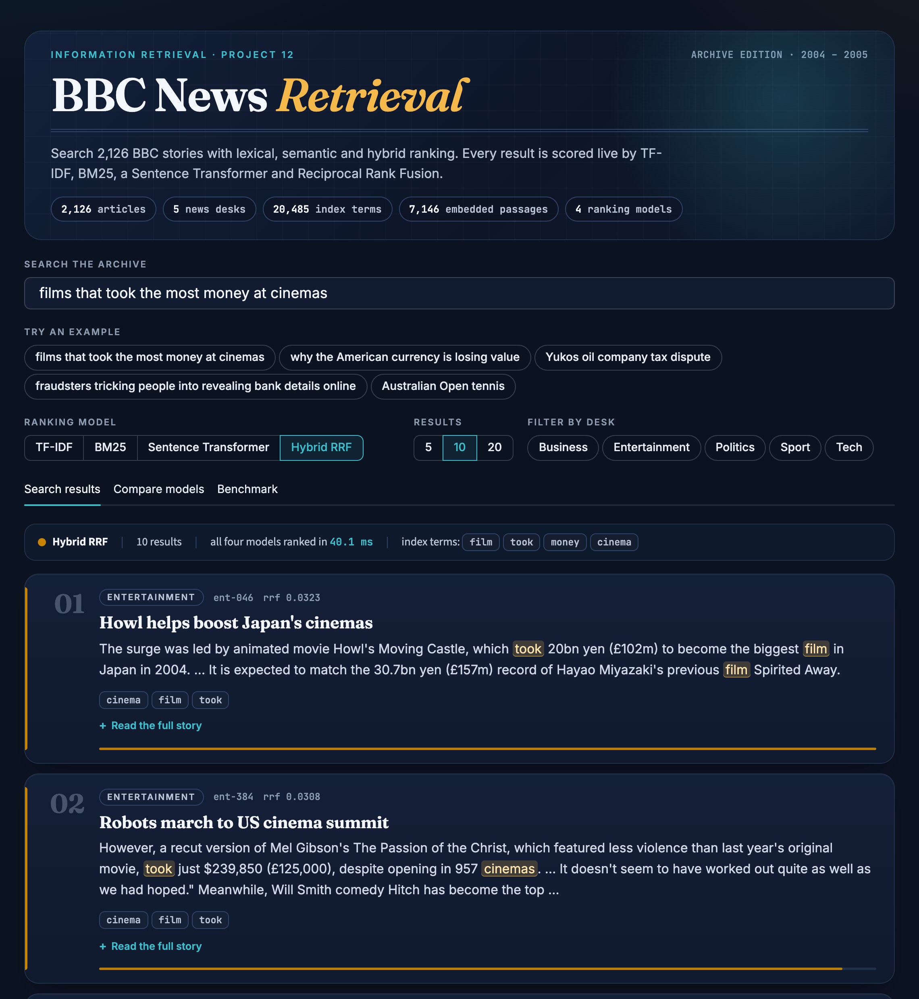
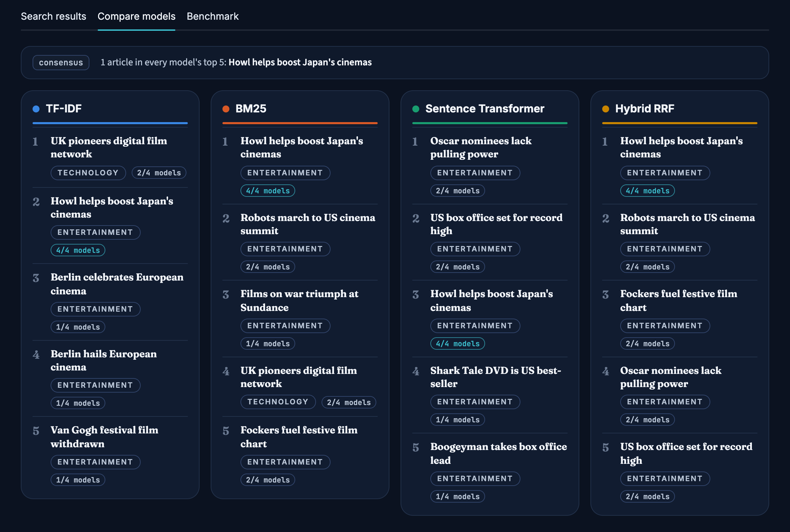
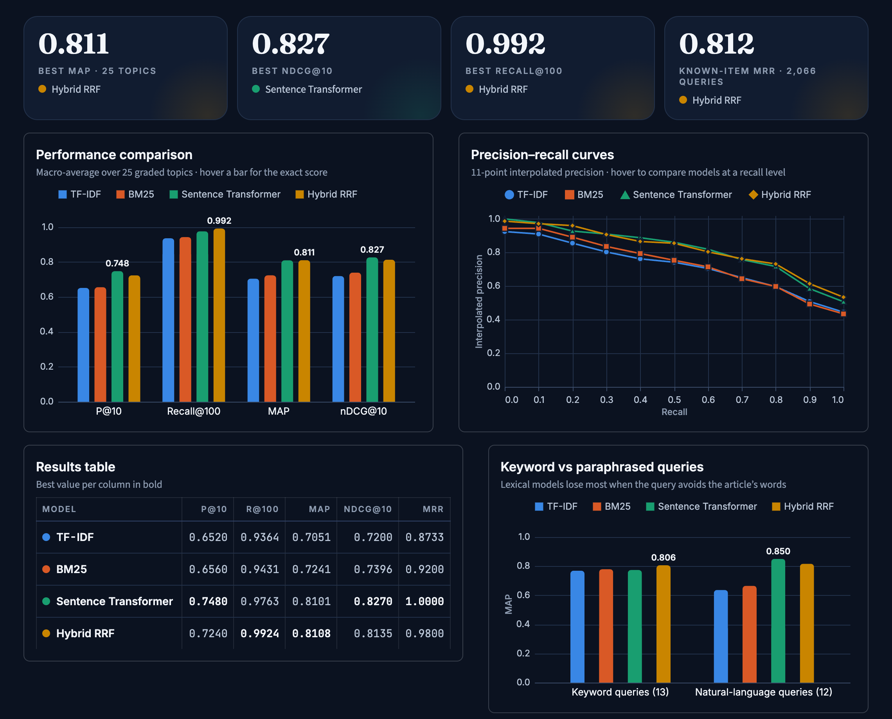
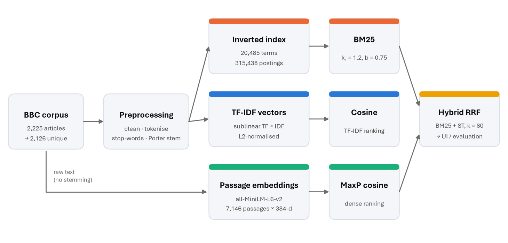

# BBC News Retrieval

**Lexical, semantic and hybrid search over the BBC News archive — with a purpose-built test collection, a full evaluation and a news-desk search interface.**




📄 [Project report (PDF)](docs/BBC_News_Retrieval_Report.pdf) · 🎞️ [Presentation (PDF)](docs/BBC_News_Retrieval_Presentation.pdf)

Information Retrieval course project 12. It searches the official BBC News corpus (2,225 articles from
2004–2005, 2,126 after de-duplication) with four rankers built over one inverted index:

| Model | How it ranks |
|---|---|
| **TF-IDF** | sublinear TF × smoothed IDF vectors, cosine similarity |
| **BM25** | Okapi BM25 (k1 = 1.2, b = 0.75) scored from the postings lists |
| **Sentence Transformer** | `all-MiniLM-L6-v2` embeddings of 7,146 passages, best-passage (MaxP) cosine |
| **Hybrid RRF** | Reciprocal Rank Fusion of BM25 and the Sentence Transformer (k = 60) |

## Results

**25 test topics, 957 graded relevance judgments** (macro-average, best in bold):

| Model | P@10 | Recall@100 | MAP | nDCG@10 |
|---|---|---|---|---|
| TF-IDF | 0.6520 | 0.9364 | 0.7051 | 0.7200 |
| BM25 | 0.6560 | 0.9431 | 0.7241 | 0.7396 |
| Sentence Transformer | **0.7480** | 0.9763 | 0.8101 | **0.8270** |
| Hybrid RRF | 0.7240 | **0.9924** | **0.8108** | 0.8135 |

**2,066 known-item queries** (find an article from its headline; headlines removed from the index):

| Model | MRR | Success@1 | Recall@10 | nDCG@10 |
|---|---|---|---|---|
| TF-IDF | 0.7530 | 0.6447 | 0.9361 | 0.7956 |
| BM25 | 0.7913 | 0.6951 | 0.9506 | 0.8286 |
| Sentence Transformer | 0.7506 | 0.6389 | 0.9356 | 0.7940 |
| Hybrid RRF | **0.8122** | **0.7154** | **0.9695** | **0.8498** |

- Semantic matching is the largest gain. Lexical models drop to MAP 0.665 (BM25) on paraphrased queries,
  while the Sentence Transformer holds 0.850.
- Hybrid RRF is the only model at the top of both tests. On the topics it ties the Sentence Transformer on MAP (not
  significant, p = 0.97); on known-item search it beats every other model (p < 0.001).
- Hybrid search costs about 4 ms per query (median, Apple-silicon GPU); BM25 alone needs 58 µs.

## The interface

A dark, newspaper-style Streamlit app: one-click example queries, a model selector and a desk filter. Results come
as cards with a score bar, highlighted snippet, matched index terms, and the full story expanding in place.

| Compare models | Benchmark and topic explorer |
|---|---|
|  |  |

The **Benchmark** tab has interactive charts and a topic explorer. The explorer re-runs any test topic live and
labels every result with its relevance grade.

## Quick start

```bash
git clone https://github.com/akshatsharma-x/BBC-News-Retrieval.git && cd BBC-News-Retrieval
python -m venv .venv && source .venv/bin/activate
pip install -r requirements.txt

# BBC article text is © BBC and is not in this repository — download the official release:
mkdir -p data/raw && curl -L -o data/raw/bbc-fulltext.zip http://mlg.ucd.ie/files/datasets/bbc-fulltext.zip
unzip data/raw/bbc-fulltext.zip -d data/raw
python scripts/prepare_data.py data/raw/bbc       # -> data/bbc_articles.csv (2,126 unique articles)

streamlit run app.py                              # search interface at http://localhost:8501
```

The first launch downloads the encoder (~90 MB) and embeds 7,146 passages (about 13 s on an Apple-silicon GPU,
longer on CPU). Embeddings are cached in `outputs/cache/`.

To reproduce every number and chart:

```bash
python scripts/evaluate.py        # experiments -> outputs/*.csv, outputs/results.json
python scripts/make_figures.py    # charts      -> outputs/figures/
```

## How it works



1. **Preprocessing** — UTF-8 decoding, HTML entities, exact-duplicate removal; lower-casing, `[a-z0-9]+` tokens,
   NLTK stop words and Porter stemming (identical for documents and queries).
2. **Indexing** — an inverted index (20,485 terms, 315,438 postings), a sparse
   TF-IDF matrix and dense passage embeddings (160-word windows, stride 120).
3. **Ranking** — TF-IDF, BM25 and the Sentence Transformer each return a ranked list. RRF fuses BM25 with the
   Sentence Transformer by rank position, so no score calibration is needed.
4. **Evaluation** — P@10, Recall@100, MAP, nDCG@10 (graded), MRR, 11-point precision–recall curves and paired
   randomisation tests. Ablations cover MaxP vs FirstP, fusion components and the RRF constant.

### Test collection

The corpus has no official queries, so a TREC-style collection was built:

- **Topics:** 25 topics, 13 keyword and 12 deliberately paraphrased natural-language queries, each with a narrative
  defining relevance.
- **Pooling:** the top 20 of five runs (879 pairs), judged blind against each topic's narrative.
- **Enrichment:** a keyword sweep of the whole archive found 42 more relevant articles.
- **Labels:** grades are 0, 1 or 2 — 347 relevant, 246 of them highly relevant. Every
  model's top 10 is 100% judged.

Judgments were made once, by a single assessor, mostly from headline and lead paragraph. See `data/qrels.json` and the
report, section 2.4.

## Repository layout

| Path | Contents |
|---|---|
| `bbcir/` | the retrieval toolkit: `data`, `preprocess`, `index`, `models`, `metrics`, `engine` |
| `app.py`, `ui/`, `.streamlit/` | Streamlit interface, theme stylesheet, HTML components, Altair charts |
| `data/` | `queries.json` (topics), `pool.json`, `qrels.json` (judgments) — ids only, no article text |
| `scripts/` | data preparation, pooling, evaluation, figures, UI screenshots |
| `outputs/` | result tables (`*.csv`, `results.json`) and figures |
| `report/` | generators for the report and slides (every claim is asserted against the results) |
| `docs/` | the project report (31-page PDF) and presentation (20 slides, PPTX and PDF) |

## Data and credits

- **Dataset:** D. Greene and P. Cunningham, *Practical Solutions to the Problem of Diagonal Dominance in Kernel
  Document Clustering*, ICML 2006 — [mlg.ucd.ie/datasets/bbc.html](http://mlg.ucd.ie/datasets/bbc.html). All rights in the
  articles belong to the BBC, so this repository contains only document ids, statistics and short excerpts in screenshots.
- **Encoder:** [sentence-transformers/all-MiniLM-L6-v2](https://huggingface.co/sentence-transformers/all-MiniLM-L6-v2).
- **Methods:** Robertson & Zaragoza (2009) for BM25; Reimers & Gurevych (2019) for Sentence-BERT; Dai & Callan (2019)
  for MaxP; Cormack et al. (2009) for RRF; Järvelin & Kekäläinen (2002) for nDCG.
